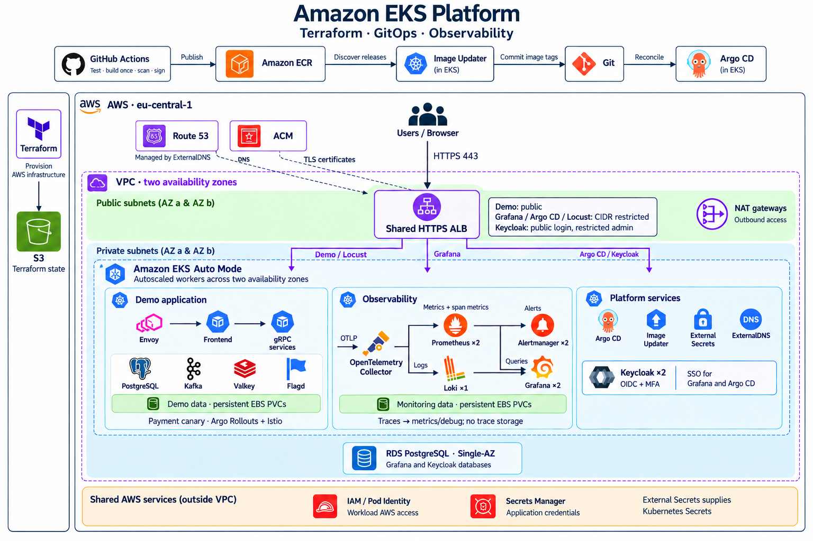

# Amazon EKS Platform with Terraform and GitOps

A portfolio project for running the OpenTelemetry demo on AWS and practicing
infrastructure automation, GitOps delivery, progressive rollouts and observability.
The repository defines one development environment. Payment, Product Catalog and
Recommendation are built from the source here; the other demo services use pinned
upstream images.

## Access

Configured endpoints, available while the environment is running:

| Interface | URL |
| --- | --- |
| Storefront | [demo.damircloud.com](https://demo.damircloud.com) |
| Load generator | [loadgen.damircloud.com](https://loadgen.damircloud.com) |
| Grafana | [grafana.damircloud.com](https://grafana.damircloud.com) |
| Argo CD | [argocd.damircloud.com](https://argocd.damircloud.com) |
| Keycloak | [auth.damircloud.com](https://auth.damircloud.com) |

## Repository layout

| Directory | Contents |
| --- | --- |
| [terraform/](terraform/) | AWS infrastructure and state-backend bootstrap |
| [platform/](platform/) | Argo CD applications and platform configuration |
| [helm/otel-demo/](helm/otel-demo/) | Demo workloads, dependencies and environment values |
| [src/](src/) | Maintained application services and their tests |
| [.github/](.github/) | CI, image publication and validation tools |

## Deploying the environment

The configuration contains project-specific AWS, GitHub, domain and certificate
references. Adapt these and provide local Terraform inputs, then follow the
[startup guide](docs/auto-mode-migration.md) for infrastructure, worker capacity,
credentials and Argo CD installation.

Terraform plans and applies are run manually. GitHub Actions validates the
infrastructure configuration; it does not deploy AWS resources.

## Operational notes

- The demo's dependency data survives pod replacement, but deleting its StatefulSets
  deletes their PVCs and volumes. Check the [storage and teardown guide](docs/dependency-storage.md)
  before removing workloads or destroying the environment.
- RDS snapshot recovery also requires the application passwords and encryption keys
  stored separately in Secrets Manager. A full Terraform destroy does not preserve
  those secrets automatically.
- CI verifies image signatures during publication. Cluster admission does not
  currently enforce signature verification.

See [CI and releases](docs/ci-and-releases.md) for validation and image publication,
[telemetry identity](docs/telemetry-identity.md) for workload attribution, and
[platform network policies](platform/network-policies/) for traffic allowlists.
